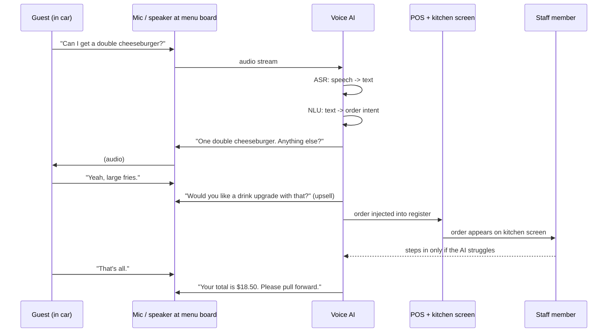
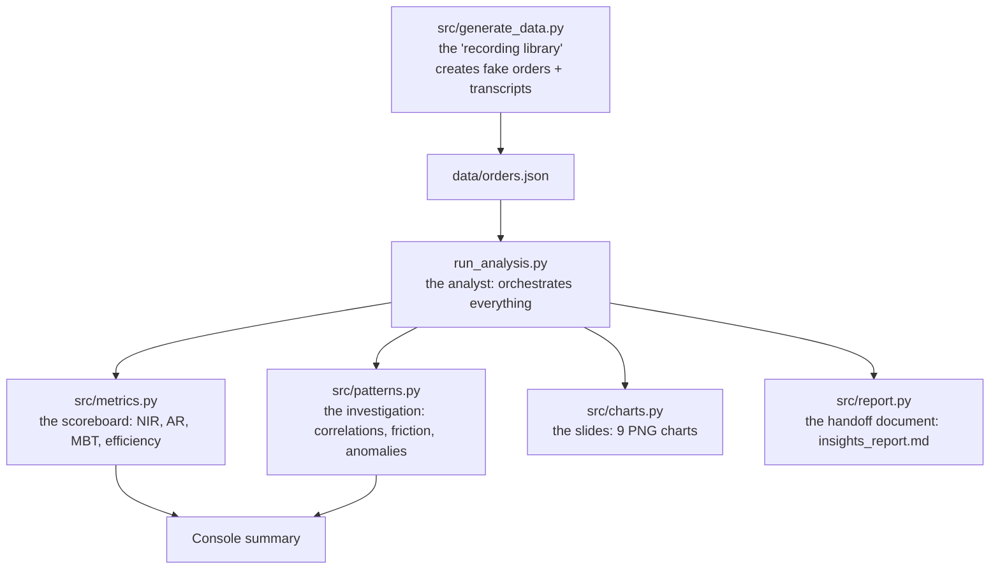

# Drive-Thru Voice AI Order Analytics

A Python project that **analyses drive-thru orders handled by a restaurant voice AI system** — the same technology that big restaurant chains use to take orders at the menu board. It reviews the actual *conversations* between the AI and guests, measures how well the AI performs, finds *why* performance dips, and produces a structured insights report — the exact workflow of a Business Analyst on a Voice AI team.

The project is deliberately **modular and commented** so an undergraduate can read it, understand it, and rebuild it themselves. There are no hidden tricks: the data is generated in `src/generate_data.py` with plain Python, and the analysis is a handful of `groupby` and `mean` calls on a pandas table.

---

## 🎙️ First: how a real drive-thru voice AI works

Before reading any code, it helps to picture the physical system. At a real drive-thru, a speaker + microphone sits at the menu board. The AI uses that audio to do this, second by second:



Key terms you will see everywhere:

| Real-world concept | What it means on the ground |
| --- | --- |
| **Menu Board Time (MBT)** | The seconds a guest spends talking to the board, from "hello" to "pull forward". If MBT climbs, the queue backs up and **revenue per lane per hour** drops. |
| **ASR** (Automatic Speech Recognition) | The audio→text step. Confidence is how sure the AI is it heard the right words. Noisy sites (highway traffic, rain, car engines) crush confidence. |
| **POS injection** | The step where the finished order is sent into the register (point of sale). If it fails, the kitchen never sees the order. |
| **Staff fallback** | When the AI struggles, it hands the guest to a human crew member. More fallbacks = less labor saved. |

Everything downstream in this project is about measuring those moments.

---

## 📌 Why build this project?

Voice AI companies hire Business Analysts to review AI interactions and turn observations into decisions. This project does the job description, end to end:

| Business Analyst responsibility | Where this project covers it |
| --- | --- |
| Track **NIR, Automation Rate, MBT, AI Efficiency** | `src/metrics.py` — the KPI "scoreboard" |
| Correlate KPIs (e.g. *high MBT → low NIR*) | `src/patterns.py` → `mbt_nir_correlation()` |
| Spot **recurring issue patterns** (ASR errors, menu mismatches, modifier mapping, POS injection) | `src/patterns.py` → `issue_breakdown()` |
| Find **where conversations break** | `src/patterns.py` → `friction_positions()` |
| Evaluate **upsell performance and revenue impact** | `src/patterns.py` → `upsell_impact()` |
| Flag **anomalies** (bad stores, extreme orders) | `src/patterns.py` → `anomaly_stores()`, `extreme_orders()` |
| Build **structured reports** with insights | `src/report.py` → `output/insights_report.md` |

---

## 🧩 What the code is, grounded

The project is **6 modules** under `src/`, plus one runner. Each module maps to a real analyst task:



| Module | Real-world job | It contains |
| --- | --- | --- |
| `generate_data.py` | Pulling recordings out of the AI platform | Generates realistic orders **with full turn-by-turn transcripts** (who said what, ASR confidence per turn, AI latency per turn) |
| `metrics.py` | "How are we doing overall?" | KPI calculations + store/region/peak-hour breakdowns |
| `patterns.py` | "Why are the numbers like this?" | MBT↔NIR correlation, issue counts, friction map, keyword mining, anomaly + extreme-order detection, upsell revenue |
| `charts.py` | Turning numbers into pictures | 9 charts saved as PNGs |
| `report.py` | The meeting handout | A structured markdown report with tables, quoted transcripts, findings, and recommendations |
| `run_analysis.py` | The analyst's morning routine | Calls everything in order: `load → measure → investigate → visualise → report` |

---

## ⚡ Quick start

Requirements: **Python 3.8+**.

```bash
git clone https://github.com/aditirad/drive-thru-voice-ai-analytics.git
cd drive-thru-voice-ai-analytics

pip install -r requirements.txt   # only pandas + matplotlib

python run_analysis.py
```

That generates 1,000 synthetic orders, analyses them, and writes everything to `output/`.

---

## 📊 What you actually get

### Terminal summary

```
=== KEY PERFORMANCE METRICS ===
Orders analysed        : 1000
Non-Intervention Rate  : 67%
Automation Rate        : 80%
AI Efficiency          : 70%
Avg Menu Board Time    : 60 sec
Avg AI reply latency   : 1051 ms
Avg ASR confidence     : 90%
Upsell attach rate     : 57%
Abandonment rate       : 5%

=== PATTERNS ===
MBT-NIR correlation (hourly): -0.38
Top issue type: modifier_mapping (129 orders)
Underperforming stores: ST-103
```

### A structured report — `output/insights_report.md`

Headline KPI table, performance by store and region, peak vs off-peak, issue breakdown, a **friction map** (which turn of the conversation breaks), **quoted transcripts** of the worst orders, upsell revenue impact, findings, and recommendations. Exactly the document an analyst hands to product and ops.

### Nine charts — `output/charts/`

| | |
| --- | --- |
|  |  |
|  |  |
|  |  |
|  |  |
|  | |

---

## 🧠 The KPIs, explained in plain language

A KPI is a ratio computed from the order table. That's all.

| KPI | Grounded meaning | Formula in code |
| --- | --- | --- |
| **NIR** (Non-Intervention Rate) | % of orders the AI finished with **zero staff help** — the purest measure of labor saved | `df["ai_completed"].mean()` |
| **AR** (Automation Rate) | % of orders the AI handled **end-to-end** (some needed a human assist, but the AI did the ordering) | `outcome.isin(["completed_ai", "assisted"]).mean()` |
| **AI Efficiency** | Of the AI-completed orders, % that needed **no corrections** — smooth, first-try orders | `corrections.eq(0).mean()` |
| **MBT** | Average **seconds** at the menu board | `mean(menu_board_time_sec)` |
| **AI reply latency** | How fast the AI answers, in milliseconds | `mean(latency_avg_ms)` |
| **ASR confidence** | How sure the AI is about the words it heard | `mean(asr_confidence)` |
| **Upsell attach rate** | Of orders where upsell was attempted, % who said yes | `upsell_accepted.mean()` (among attempted) |

**The one correlation that matters** — `src/patterns.py`:

```python
hourly = df.groupby("hour").agg(
    nir=("ai_completed", "mean"),
    mbt=("menu_board_time_sec", "mean"),
)
corr = hourly["nir"].corr(hourly["mbt"])   # ≈ -0.38 in our data
```

Negative correlation = *when boards get slow, the AI needs help more often.* In a real restaurant, slow boards mean a backed-up lane and lost revenue, so this single number tells the ops team exactly where to focus.

---

## 🗃️ The data model, grounded

Real recordings are private, so `generate_data.py` **builds fake ones that behave like the real system**. The data lives in `data/orders.json`:

```
order (one row in the table)
├── who: store_id, store_name ("Highway Exit"), region, day, hour, is_peak
├── what: items ordered, base_total, total
├── upsell: attempted? which item? accepted? $ added?
├── how it ended: outcome (completed_ai / assisted / abandoned / error)
├── performance: menu_board_time_sec, asr_confidence, latency_avg_ms
├── problems: issues list + num_issues + corrections
├── sentiment_score  (guest's mood, roughly)
└── transcript: [ {speaker, text, asr_confidence, latency_ms}, ... ]  ← the conversation itself
```

The transcript is what makes this project different from a toy dashboard: **the analysis can point at the actual turns** where things went wrong. For example, the report's "Most extreme orders" section quotes the real transcript:

```
> ORD-1074 (Highway Exit, day 26, Fri 18:00) - assisted, MBT 109s
> AI: Welcome to the drive-thru. What can I get you today?
> Guest: I'll have a chicken tenders
> AI: One moment while I send that to the kitchen...
> AI: Sorry for the wait, confirmed.
```

Why is the data generated? Because you can't share real call audio. The generator **encodes the real physics** of the system — noisy stores and rush hours cause more ASR errors, errors make the AI less likely to finish alone, and slow, error-filled orders frustrate guests. That's why the analysis finds genuine patterns (ST-103 "Highway Exit" always underperforms — its `noise` is 1.6 vs 0.8 at the quietest site).

---

## 👩‍💻 Build it yourself, step by step

If you want to reimplement this, here's the whole thought process, module by module.

### Step 0 — Libraries

```python
import pandas as pd                 # tables + calculations
import matplotlib.pyplot as plt     # charts
```

That's the entire dependency list.

### Step 1 — The data generator (`src/generate_data.py`)

Start with the building blocks: stores, a menu, upsell items, the four issue types, and the outcomes. Then write one function that builds a *transcript* — a list of `(speaker, text)` turns:

```python
def build_transcript(items, issues, outcome, upsell_item, upsell_accepted, total):
    turns = [("ai", "Welcome to the drive-thru. What can I get you today?")]
    for item in items:
        turns.append(("guest", f"I'll have a {item}"))
        turns.append(("ai", f"One {item}. Anything else?"))
    ...
    return turns
```

Then decorate each turn with data: an ASR confidence for guest turns, a latency for AI turns (`enrich_turns`). Finally `build_order()` glues it all together and computes the order-level fields. **The trick:** make the outcome depend on noise, errors, and peak hours *inside the generator*, so the later analysis has real structure to find.

### Step 2 — The scoreboard (`src/metrics.py`)

Every KPI is one line:

```python
kpis["nir"] = df["ai_completed"].mean()     # % orders with zero staff help
kpis["mbt"] = df["menu_board_time_sec"].mean()
```

### Step 3 — The investigation (`src/patterns.py`)

Four small ideas, all using pandas:

```python
# correlation
hourly = df.groupby("hour").agg(nir=("ai_completed", "mean"),
                                mbt=("menu_board_time_sec", "mean"))
corr = hourly["nir"].corr(hourly["mbt"])

# issue counts (df["issues"] is a list column)
pd.Series([i for issues in df["issues"] for i in issues]).value_counts()

# friction map: scan transcripts, count repeats by turn number
for turns in df["transcript"]:
    for idx, turn in enumerate(turns):
        if turn["speaker"] == "guest" and "repeat" in turn["text"].lower():
            positions.append(idx + 1)

# anomaly: flag stores more than 1 std below the average store NIR
store_nir[store_nir < store_nir.mean() - store_nir.std()]
```

### Step 4 — The slides (`src/charts.py`)

Five lines per chart:

```python
df.groupby("hour")["menu_board_time_sec"].mean().plot(kind="line", marker="o")
plt.title("Average Menu Board Time by Hour")
plt.savefig("output/charts/mbt_by_hour.png")
```

### Step 5 — The handoff document (`src/report.py`)

Build a markdown string and write it to a file. Tables via string joins, quotes via a small helper that renders transcript turns as `>` lines. This is the deliverable — analysis only matters if it changes what the team does next.

### Step 6 — The runner (`run_analysis.py`)

```python
df = load_data()                 # generate + read + add ai_completed column
kpis = compute_kpis(df)
store_stats = by_store(df)
hourly, corr = mbt_nir_correlation(df)
issue_counts = issue_breakdown(df)
anomalies = anomaly_stores(df)
save_all(df, kpis, hourly, issue_counts, friction, store_stats)
write_report(...)
```

That's the whole project. If you can explain each function, you understand the pipeline — and that's exactly the "analytical + curious" signal an interviewer wants.

---

## 🔄 Extensions to try next

- **Real data** — replace `generate_dataset()` with `pd.read_csv("your_export.csv")` from a real AI platform.
- **Real sentiment** — compute `sentiment_score` with `nltk`'s free VADER model instead of a stored value.
- **Statistical tests** — is ST-103's NIR difference *significant*? `scipy.stats.fisher_exact` on a 2×2 table.
- **Forecasting** — predict tomorrow's MBT from today's with a simple moving average or `sklearn` linear regression.
- **Dashboard** — wrap the charts in Streamlit for a clickable review tool.
- **Alerting** — run the anomaly detection daily and page the ops channel when a store drops.

---

## 🧰 Tech stack

| Tool | Why |
| --- | --- |
| **Python 3** | simple, everywhere, standard for data work |
| **pandas** | tables, `groupby`, `.mean()`, `.corr()` — the analyst's main tool |
| **matplotlib** | charts saved as PNGs |
| **JSON** | the storage format for orders + transcripts |

---

## 📁 Project structure

```
drive-thru-voice-ai-analytics/
├── run_analysis.py            # entry point - runs the whole pipeline
├── requirements.txt           # pandas + matplotlib
├── README.md                  # this file
├── src/
│   ├── generate_data.py       # synthetic orders + transcripts
│   ├── metrics.py             # KPI calculations
│   ├── patterns.py            # correlations, friction, anomalies, keywords
│   ├── charts.py              # 9 charts -> output/charts/
│   └── report.py              # insights report -> output/insights_report.md
├── data/
│   └── orders.json            # generated dataset (1,000 orders)
└── output/
    ├── insights_report.md     # the deliverable
    └── charts/                # 9 PNG charts
```

---

*Built as a beginner-friendly, reproducible data analysis project. All data is 100% synthetic (generated with a fixed random seed) so the pipeline runs anywhere and produces the same results.*
