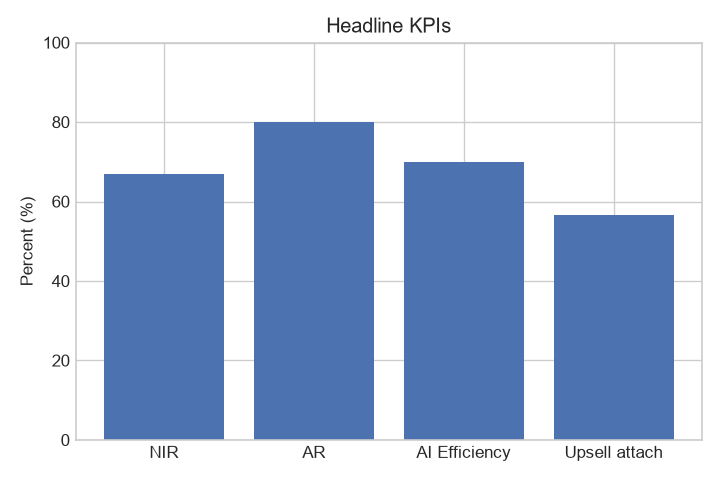
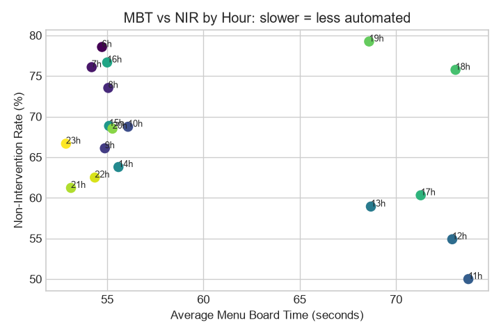
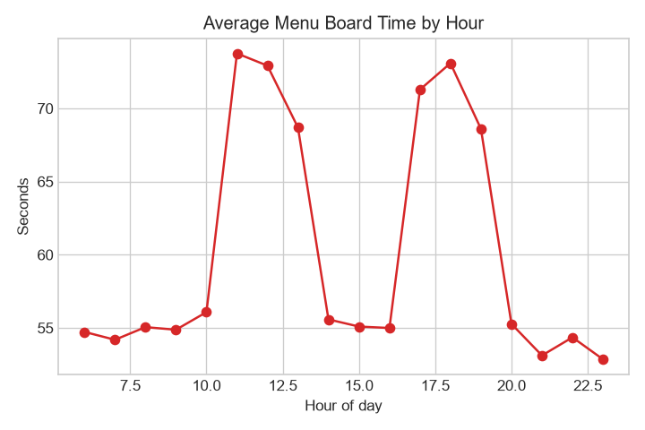
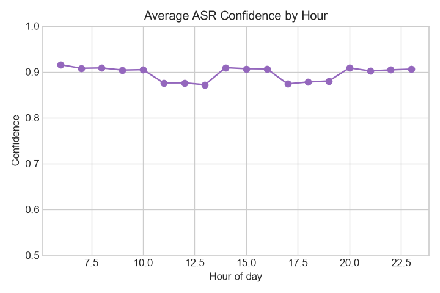
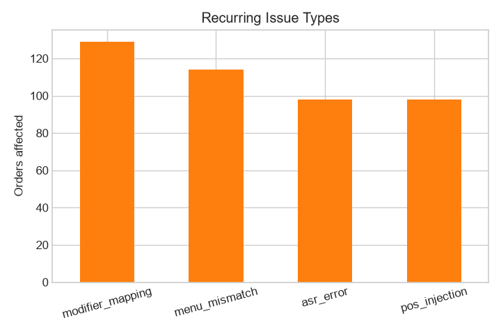
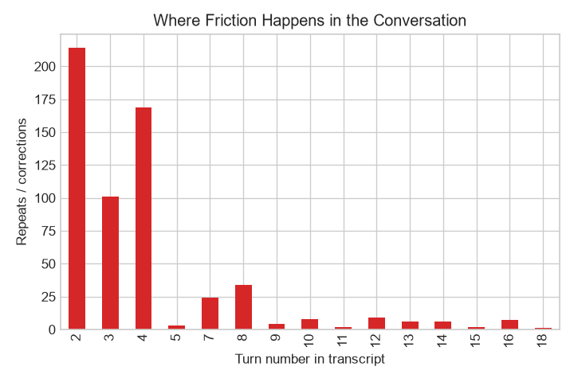
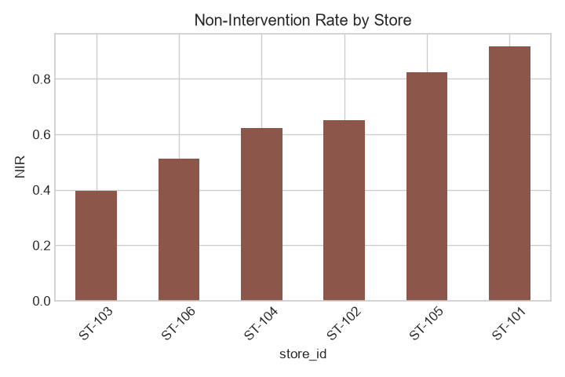
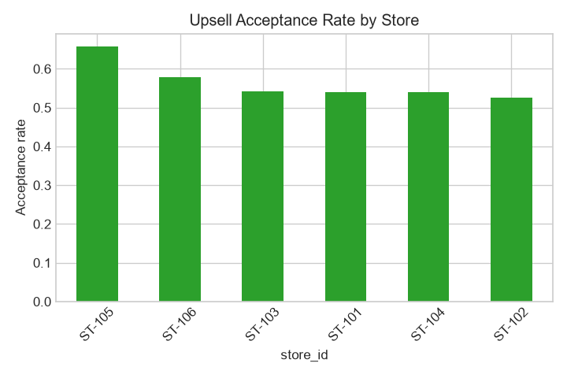
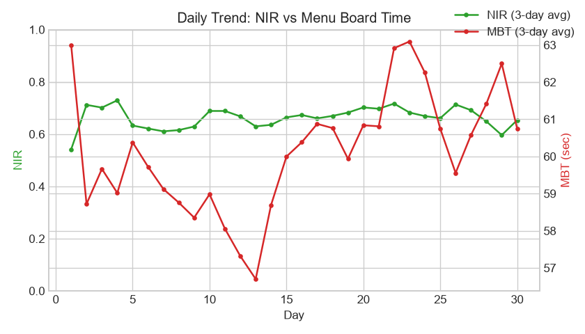

# Drive-Thru Voice AI - Insights Report

_Generated by `run_analysis.py` on 1000 synthetic orders (30 days)_

## Executive summary

The AI completes **67%** of orders with zero staff help (NIR) and automates **80%** end-to-end. Average Menu Board Time is **60s**. The strongest signal in the data is the **-0.38 correlation** between Menu Board Time and NIR: when orders take longer, the AI needs help more often. The most common failure is **modifier_mapping**, and friction is tied to the turns where guests state their items.

## 1. Headline KPIs

| KPI | Value |
| --- | --- |
| Orders analysed | 1000 |
| Non-Intervention Rate (NIR) | 67% |
| Automation Rate (AR) | 80% |
| AI Efficiency (zero-correction completions) | 70% |
| Average Menu Board Time (MBT) | 60 sec |
| Average AI reply latency | 1051 ms |
| Average ASR confidence | 90% |
| Upsell attach rate (when attempted) | 57% |
| Abandonment rate | 5% |
| Average guest sentiment | +0.19 |
| Average ticket | $17.95 |

## 2. Performance by store

| Store | NIR | MBT (sec) | ASR | Upsell attach | Avg issues | Orders |
| --- | --- | --- | --- | --- | --- | --- |
| ST-103 (Highway Exit) | 40% | 62 | 87% | 54% | 0.52 | 83 |
| ST-106 (Train Station) | 51% | 60 | 89% | 58% | 0.50 | 76 |
| ST-104 (Airport Rd) | 62% | 60 | 90% | 54% | 0.43 | 74 |
| ST-102 (Mall Food Court) | 65% | 61 | 90% | 52% | 0.53 | 80 |
| ST-105 (Suburb West) | 82% | 58 | 91% | 66% | 0.39 | 79 |
| ST-101 (Downtown Ave) | 92% | 58 | 92% | 54% | 0.33 | 61 |

## 3. Performance by region

| Region | NIR | MBT (sec) | Upsell attach | Avg issues |
| --- | --- | --- | --- | --- |
| A | 77% | 60 | 53% | 0.44 |
| C | 67% | 59 | 62% | 0.45 |
| B | 50% | 61 | 54% | 0.48 |

## 4. Peak hours vs off-peak

| Period | NIR | MBT (sec) | ASR | Avg issues |
| --- | --- | --- | --- | --- |
| Off-peak | 69% | 55 | 91% | 0.40 |
| Peak hours | 62% | 71 | 88% | 0.52 |

## 5. Recurring issue types

| Issue type | Orders affected |
| --- | --- |
| modifier_mapping | 129 |
| menu_mismatch | 114 |
| asr_error | 98 |
| pos_injection | 98 |

## 6. Friction map (where conversations break)

| Turn number | Repeats / corrections |
| --- | --- |
| Turn 2 | 214 |
| Turn 3 | 101 |
| Turn 4 | 169 |
| Turn 5 | 3 |
| Turn 7 | 24 |
| Turn 8 | 34 |

## 7. Guest phrases in abandoned orders

| Word | Count |
| --- | --- |
| fries | 106 |
| milkshake | 104 |
| veggie | 104 |
| wrap | 104 |
| classic | 99 |
| burger | 99 |
| onions | 97 |
| double | 95 |

## 8. Key findings

- Correlation between hourly Menu Board Time and NIR: **-0.38** (negative = slower boards mean less automation).
- Top issue type: **modifier_mapping** (129 orders) - the highest-impact thing to fix.
- Friction is tied to item-ordering turns (2, 4, 6...): the AI most often mishears or mis-maps items right as the guest states them.
- - **1 store(s) underperform**: ST-103 - investigate site noise and ASR tuning.

## 9. Anomalies

**Underperforming stores** (NIR more than 1 std below average):

| Store | NIR |
| --- | --- |
| ST-103 | 40% |

**Most extreme orders** (MBT above Q3 + 1.5*IQR = 103s):

> **ORD-1039** (Airport Rd, day 21, Sun 12:00) - assisted, MBT 120s
> AI: Welcome to the drive-thru. What can I get you today?
> Guest: I'll have a classic burger
> AI: One large classic burger, got it.
> Guest: No, a regular classic burger.
> AI: One classic burger. Anything else?
> Guest: I'll have a veggie wrap

> **ORD-1386** (Highway Exit, day 14, Sun 11:00) - error, MBT 111s
> AI: Welcome to the drive-thru. What can I get you today?
> Guest: I'll have a veggie wrap
> AI: Sorry, I didn't catch that. Could you repeat?
> Guest: I said, I'll have a veggie wrap
> AI: One veggie wrap. Anything else?
> Guest: I'd like a double cheeseburger

> **ORD-1481** (Airport Rd, day 20, Sat 13:00) - completed_ai, MBT 111s
> AI: Welcome to the drive-thru. What can I get you today?
> Guest: I'd like a chicken tenders
> AI: Sorry, I didn't catch that. Could you repeat?
> Guest: I said, I'd like a chicken tenders
> AI: One chicken tenders. Anything else?
> Guest: I'd like a soft drink

## 10. Upsell revenue impact

Over the 30 days sampled, the AI attempted 453 upsells, **256 were accepted** (57% attach), adding **$322.50** of revenue (avg $0.71 per accepted order).

## 11. Recommendations

1. **Retrain on the top issue type first** - it affects the most orders.
2. **Tune the noisy store(s)** - raise ASR thresholds / add noise filtering where NIR is far below average.
3. **Guard the first few turns** - most friction happens while the guest states their first items; slow down and re-confirm there.
4. **Use rush-hour escalation** - hand long orders to staff sooner during peak hours instead of looping the AI.
5. **Keep the upsell playbook** - it adds real revenue; tune prompts at stores with below-average attach.

## 12. Charts

